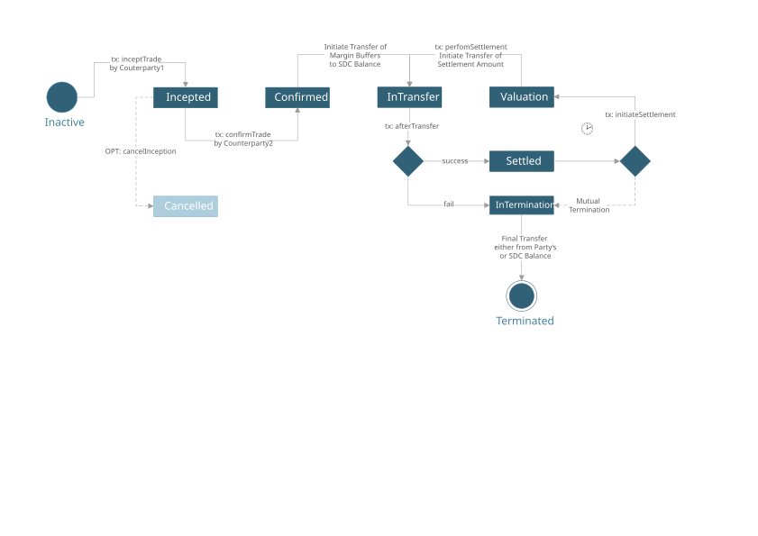
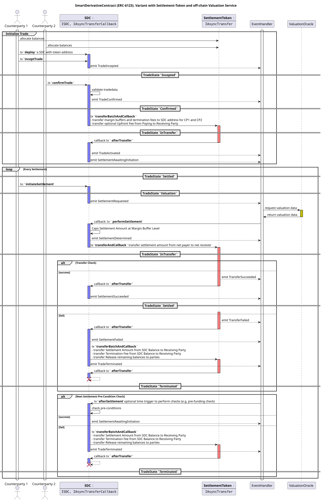
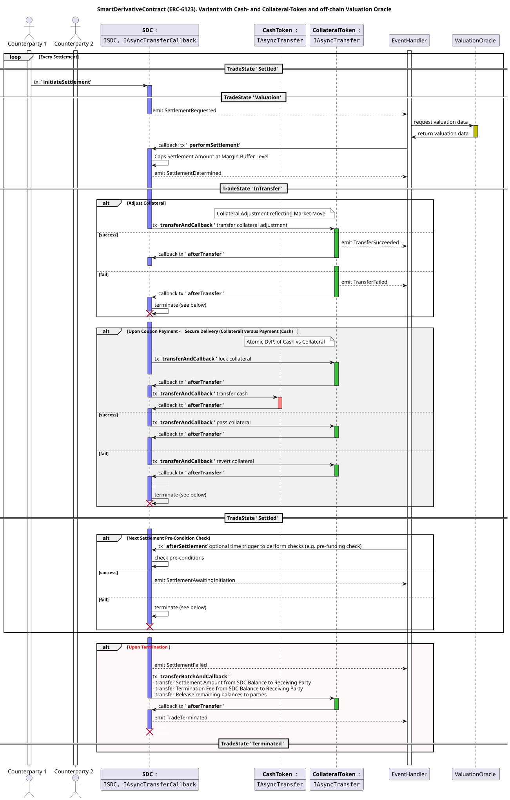

## Abstract

The Smart Derivative Contract (SDC) allows fully automizing and securing a financial product's - e.g. a financial derivative or bond - complete trade life cycle.[^1]
The SDC leverages the advantages of smart contracts to remove many of the frictions associated with the classical derivative life cycle. Most notably, the protocol allows the removal of counterpart risk essentially.
The SDC can be implemented using a pre-agreed valuation oracle and valuation model, removing ambiguity in the settlement amounts. The SDC provides methods and callbacks to enable fully automated and fully transactional settlements (delivery-versus-payment, payment-vs-payment).
Token-based settlement can be realized by any contract implementation implementing an [ERC-20](https://eips.ethereum.org/EIPS/eip-20) token.
Proof of concepts in terms of two legally binding digital Interest Rate Swaps were conducted in 2021 and 2022.

## Motivation

### Rethinking Financial Derivatives

By their very nature, so-called "over-the-counter (OTC)" financial contracts are bilateral contractual agreements on exchanging long-dated cash flow schedules.
Since these contracts change their intrinsic market value due to changing market environments, they are subject to counterparty credit risk when one counterparty is subject to default.
The initial white paper describes the concept of a Smart Derivative Contract (SDC) with the central aim to detach bilateral financial transactions from counterparty credit risk and to remove complexities
in bilateral post-trade processing by a complete redesign.

### Concept of a Smart Derivative Contract

A Smart Derivative Contract is a deterministic settlement protocol with the same economic behaviour as a Financial Contract - e.g. an OTC-Derivative or a Bond.
Every process state is specified; therefore, the trade and post-trade process is known in advance and is deterministic over the trade's life cycle. An [ERC-20](https://eips.ethereum.org/EIPS/eip-20) token can be used for frictionless decentralized settlement, see reference implementation. We do provide a separate interface and implementation for a specific "Settlement Token" derived from [ERC-20](https://eips.ethereum.org/EIPS/eip-20).
These features enable two or multiple trade parties to process their financial contracts fully decentralized without relying on a third central intermediary agent.
The process logic of SDC can be implemented as a finite state machine on solidity.

### Applications

The interface's life cycle functionality applies to several use cases.

#### Settle-to-Market OTC Derivative

In the case of a settle-to-market OTC derivative, an SDC settles the outstanding net present value of the underlying financial contract on a frequent (e.g. daily) basis. With each settlement cycle, the net present value of the underlying contract is exchanged, and the value of the contract is reset to zero. Pre-agreed margin buffers are locked at the beginning of each settlement cycle so that settlement will be guaranteed up to a certain amount.
If a counterparty fails to obey contract rules, e.g. not providing sufficient pre-funding, SDC will terminate automatically with the guaranteed transfer of a termination fee by the causing party.
We provide a reference implementation for this case.

#### Callateralized OTC Derivative

An implementation variante of the protocol can be used to realize a collateralized OTC derivative.[^2]
Here the contract manages separate collateral and cash tokens.
The constructions allows to eliminate the risk of under-collateralization.
Thus, a separate initial margin is not required.

#### Defaultable OTC Derivative

A defaultable OTC Derivative has no Collateral Process in place. In that case, a smart derivative will settle the according cash flows as determined in the derivative contract specification. A defaultable OTC derivative might end in
a state 'Failure to Pay' if a settlement cannot be conducted.

#### Smart Bond Contract

The life cycle of a bond can also make use of the function catalogue below. The interface enables the issuer to allocate and redeem the bond as well as settle coupon payments. On the other hand, it allows bondholders to interact with each other, conducting secondary market trades. It all boils down to a settlement phase, which needs to be pre-agreed by both parties or triggered by the issuer
which can be processed in a completely frictionless way.

## Specification

The methods and event are separated into different interfaces:

- `ISDCTrade` - events and functions related to trade inception, confirmation and termination.
- `ISDCSettlement` - events and functions related to the settlement life-cycle of a trade.
- `IAsyncTransferCallback` - events and the callback function `afterTransfer` for settlements that utilize and external payment system.
- `IAsyncTransfer` - events and functions related to async transfer (e.g., for external payment systems).

The `ISDC` interface is the aggregation of `ISDCTrade`, `ISDCSettlement` and `IAsyncTransferCallback`.

### Methods of `ISDCTrade`

The trade interface separates economic participants from the submitting caller.
`inceptor` and `counterparty` MUST be supplied explicitly and MUST identify distinct,
nonzero participants permitted by the implementation. `msg.sender` identifies the
caller; its address alone MUST NOT determine either participant.

Implementations MUST enforce their authorization policy for the requested action.
Inception and inception cancellation require authority for the inceptor; confirmation
requires authority for the counterparty. Implementations MAY accept direct participant
calls, delegated operators, authenticated signed instructions, or other independently
authenticated workflows. An explicit participant address or a token allowance does
not, by itself, grant authority to agree to a trade on that participant's behalf.
The authorization mechanism is outside this interface.

At inception, the implementing contract MUST generate and return a nonempty `tradeId`.
Each identifier is lifetime-unique within that contract: an implementation MUST NOT
reuse an identifier, including after its original inception was canceled or completed.
The identifier-generation algorithm is implementation-defined.

The first valid inception binds that identifier, the two participants and all supplied
trade terms. Confirmation and cancellation MUST match every argument against that
inception, including the identifier, all string fields and both signed amounts, and
MUST validate the lifecycle state. An incepted proposal MUST NOT be overwritten by
another inception. A completed or canceled proposal MUST NOT be executed again.
Implementations that accept a later inception MUST generate a new, unused identifier;
identical economic terms do not make the new proposal interchangeable with the old one.

Both `position` and `paymentAmount` are always expressed from the inceptor's
perspective: positive means receive, negative means deliver. Confirmation repeats
the same participant order and signed values; it does not negate them.

#### Trade Initiation Phase: `inceptTrade`

An authorized caller proposes a trade for the explicit inceptor and counterparty.
The implementation stores the complete inception and emits `TradeIncepted`, identifying
the economic inceptor even if an operator submitted the transaction.

```solidity
function inceptTrade(
    address inceptor,
    address counterparty,
    string memory tradeData,
    int256 position,
    int256 paymentAmount,
    string memory initialSettlementData
) external returns (string memory tradeId);
```

The implementation returns the generated `tradeId` and includes the same value in
`TradeIncepted`. Trade identifier representation remains a string. Callers use this
identifier for subsequent confirmation, cancellation and termination.

#### Trade Initiation Phase: `confirmTrade`

An authorized caller confirms on behalf of the stored counterparty. Every argument
MUST match the stored inception. The implementation emits `TradeConfirmed` for that
counterparty and may activate or settle the agreed trade according to its lifecycle.

```solidity
function confirmTrade(
    string memory tradeId,
    address inceptor,
    address counterparty,
    string memory tradeData,
    int256 position,
    int256 paymentAmount,
    string memory initialSettlementData
) external;
```

For example, an inception describing A receiving 100 units and paying 110 units is
confirmed by B or B's authorized operator using exactly the same tuple:

```solidity
string memory tradeId = inceptTrade(A, B, tradeData, 100, -110, initialSettlementData);
confirmTrade(tradeId, A, B, tradeData, 100, -110, initialSettlementData);
```

The implementation MUST derive transfer destinations from the agreed participants,
not from the caller's address.

#### Trade Initiation Phase: `cancelTrade`

The inceptor or an authorized caller acting for it can withdraw an unconfirmed
trade. Every argument MUST match the stored inception. Cancellation MUST reject
an already confirmed or canceled proposal and emits `TradeCanceled` for the inceptor.
The canceled identifier MUST remain unavailable for future inception. A later proposal
with identical participants and terms still requires a new identifier.

```solidity
function cancelTrade(
    string memory tradeId,
    address inceptor,
    address counterparty,
    string memory tradeData,
    int256 position,
    int256 paymentAmount,
    string memory initialSettlementData
) external;
```

#### Trade Termination: `requestTradeTermination`

An authorized caller requests termination for `requestingParty`, which MUST be a
participant in the identified trade. The trade's stored participants identify the
opposite party. The complete proposal, including the requester, MUST be retained
for matching. The signed payment is expressed from the requester's perspective.

```solidity
function requestTradeTermination(
    string memory tradeId,
    address requestingParty,
    int256 terminationPayment,
    string memory terminationTerms
) external;
```

#### Trade Termination: `confirmTradeTermination`

Confirmation requires authority for the stored participant opposite `requestingParty`.
Every argument MUST match the pending request, including the unchanged payment sign.
Confirmation may trigger the termination settlement. An already confirmed request
MUST NOT trigger a second settlement.

```solidity
function confirmTradeTermination(
    string memory tradeId,
    address requestingParty,
    int256 terminationPayment,
    string memory terminationTerms
) external;
```

#### Trade Termination: `cancelTradeTermination`

Cancellation requires authority for the original requesting party. Every argument
MUST match the pending proposal. The implementation MUST validate that its lifecycle
still permits withdrawal and MUST reject canceled or completed requests. An asynchronous
implementation may permit withdrawal after confirmation while settlement has not
executed, subject to its locking and settlement rules.

```solidity
function cancelTradeTermination(
    string memory tradeId,
    address requestingParty,
    int256 terminationPayment,
    string memory terminationTerms
) external;
```

### Methods of `ISDCSettlement`

#### Settlement Phase: `initiateSettlement`

Allows eligible participants (such as counterparties or a delegated agent) to trigger a settlement phase.

```solidity
function initiateSettlement() external;
```

#### Settlement Phase: `performSettlement`

Valuation may be provided on-chain or off-chain via an external oracle service that calculates the settlement or coupon amounts and uses external market data.
This method serves as a callback called from an external oracle providing settlement amount and used settlement data, which also get stored.
The settlement amount will be checked according to contract terms, resulting in either a regular settlement or a termination of the trade.

The method may perform a synchonous transfer of the settlement or make use of an `IAsyncTransfer`, which will finalize the
transfer though the callback `afterTransfer`.

The transactionData is emitted as part of the corresponding event: `SettlementTransferred` or `SettlementFailed`
This might result in a termination or start of the next settlement phase, depending on the provided success flag.

The parameter `settlementData` will be ussed as `lastSettlementData` as part of the `SettlementRequested` event (see there)
and may contain updates to the determination of the next settlement, e.g., data to determine the reference value for margining or
the specification of updated margin buffer values.

```solidity
function performSettlement(int256 settlementAmount, string memory settlementData) external;
```

#### Settlement Phase: `afterSettlement`

The method is called to verify and prepare the next settlement and move to that phase.
The method may trigger optional checks (e.g. pre-funding check).

Depending on the implementation, this method may be called automatically at the end of performSettlement
or called externally (e.g. from a time-oracle to allow for a time-period to prepare the next settlement).

- An implementation that uses adjusting of pre-funding can check the pre-funding within this method.
- An implementation that checked a static pre-funding upon confirmation of the trade might not require this step.

In any case, the method may trigger termination if the settlement failed.

Emits a `SettlementTransferred` or a `SettlementFailed` event. May emit a `TradeTerminated` event.

```solidity
function afterSettlement() external;
```

### Methods of `IAsyncTransferCallback`

#### Settlement Phase: `afterTransfer`

This method is called back from a settlement token or from an eligible address if the transfer of the settlement
amount was successful. - completes the settlement transfer.
The transactionData is emitted as part of the corresponding event: `SettlementTransferred` or `SettlementFailed`
This might result in a termination or start of the next settlement phase, depending on the provided success flag.

```solidity
function afterTransfer(bool success, uint256 transactionID, string memory transactionData) external;
```

### Trade Events

The following events are emitted during an SDC trade lifecycle. `initiator` and
`confirmer` identify the represented economic participants, which may differ from
`msg.sender`. In both termination request and confirmation events, `terminationPayment`
uses the original requesting party's perspective. Implementations MAY emit additional
events identifying the submitting operator.

#### TradeIncepted

Emitted on trade inception - method 'inceptTrade'

```solidity
event TradeIncepted(address initiator, address withParty, string tradeId, string tradeData, int256 position, int256 paymentAmount, string initialSettlementData);
```

#### TradeConfirmed

Emitted on trade confirmation - method 'confirmTrade'

```solidity
event TradeConfirmed(address confirmer, string tradeId);
```

#### TradeCanceled

Emitted on trade cancellation - method 'cancelTrade'

```solidity
event TradeCanceled(address initiator, string tradeId);
```

#### TradeActivated

Emitted when a Trade is activated

```solidity
event TradeActivated(string tradeId);
```

#### TradeTerminationRequest

Emitted when termination request is initiated by a counterparty

```solidity
event TradeTerminationRequest(address initiator, string tradeId, int256 terminationPayment, string terminationTerms);
```

#### TradeTerminationConfirmed

Emitted when termination request is confirmed by a counterparty

```solidity
event TradeTerminationConfirmed(address confirmer, string tradeId, int256 terminationPayment, string terminationTerms);
```

#### TradeTerminationCanceled

Emitted when termination request is canceled by the requesting counterparty

```solidity
event TradeTerminationCanceled(address initiator, string tradeId, string terminationTerms);
```

#### TradeTerminated

Emitted when trade is terminated

```solidity
event TradeTerminated(string tradeId, string cause);
```


### Settlement Events

The following events are emitted during the settlement phases.

#### SettlementRequested

Emitted when a settlement is requested (via `initiateSettlement`). May trigger the settlement phase.

The argument `lastSettlementData` is the one that was passed upon a previous settlement
in `performSettlement` (under the name `settlementData`). It may be used to pass updated settlement
specific information calculated during the previous settlement, e.g., when margin buffer amounts are a function
of market parameters. In case of an external oracle it can pass the `settlementData` via `performSettlement`
and pick it up in the `SettlementRequested` event (allows for stateless external oracles).

```solidity
event SettlementRequested(address initiator, string tradeData, string lastSettlementData);
```

#### SettlementDetermined

Emitted when the settlement phase is started (via `performSettlement`).

```solidity
event SettlementDetermined(address initiator, int256 settlementAmount, string settlementData);
```

#### SettlementTransferred

Emitted when the settlement succeeded.

```solidity
event SettlementTransferred(string transactionData);
```

#### SettlementFailed

Emitted when the settlement failed.

```solidity
event SettlementFailed(string transactionData);
```


## Backwards Compatibility

This draft revision changes the selectors of all six `ISDCTrade` methods by adding
an explicit participant address. Confirmation and cancellation additionally receive
the generated `tradeId` as their first argument. Inception continues to generate and
return the identifier. Trade confirmation repeats the inceptor's
participant order and signed amounts. Termination confirmation repeats the requester's
signed payment. Callers, generated bindings, tests and event consumers MUST be updated
for these conventions; changing the selector alone is insufficient.

The event signatures in `ISDCTrade.sol` remain unchanged, but participant fields
identify economic parties and the termination confirmation amount uses the requester's
perspective. The `ISDC` aggregation, trade identifier type, settlement methods and
callback signatures are unchanged. Older deployed implementations continue to use
their original ABI and conventions.

## Rationale

The interface design and reference implementation are based on the following considerations:

- An SDC protocol enables interacting parties to initiate and process a financial transaction in a bilateral and deterministic manner. Settlement and Counterparty Risk is managed by the contract.
- The provided interface specification is supposed to completely reflect the entire trade life cycle.
- The interface specification is generic enough to handle the case that parties process one or even multiple financial transactions (on a netted base)
- Usually, the valuation of financial trades (e.g. OTC Derivatives) will require advanced valuation methodology to determine the market value. This is why the concept might rely on an external market data source and hosted valuation algorithms
- A pull-based valuation-based oracle pattern can be implemented by using the provided callback pattern (methods: `initiateSettlement`, `performSettlement`)
- The reference implementation `SDCSingleTrade.sol` considers a single trade and is based on a state-machine pattern where the states also serve as guards (via modifiers) to check which method is allowed to be called at a particular given process and trade state
- The interface allows the extension to multiple trades with common (netted) settlement.

### State diagram of trade and process states



The diagram shows the trade states of a single trade SDC as in `SDCSingleTrade.sol`.

### Sequence diagram of reference implementation 'SDCPledgedBalance.sol'

The following sequence diagram shows the function calls that create the trade and stellement state transitions
and the emitted events.  Shown is the implementation variante that

- utilizes an asynchronous settlement through a settlement token (see the interface `IAsyncTransfer`, `IAsyncTransferCallback`)
- receives the trigger `afterSettlement` to perfrom checks of settlement pre-conditions (see the corresponding method description `afterSettlement`)



### Sequence diagram of an implementation variant with a separate collateral account

The following sequence diagram shows the implementation variant with a separate collateral account.
This diagram show the settlement phase.



## Test Cases

Life-cycle unit tests based on the sample implementation and usage of [ERC-20](https://eips.ethereum.org/EIPS/eip-20) token is provided. See file [test/SDCTests.js](./test/SDCTests.js)
).

## Reference Implementation

The [single-trade base](./contracts/SDCSingleTrade.sol) and
[pledged-balance implementation](./contracts/SDCSingleTradePledgedBalance.sol)
provide the derivative reference lifecycle. The FX examples and fixed-rate bond
also implement the explicit-party trade interface.

The examples share [TradeAuthorizable](./contracts/TradeAuthorizable.sol), a concrete,
optional authorization policy. Each participant can call `setTradeOperator(operator,
approved)` to grant or revoke an operator for all six trade actions on that contract.
Approvals are checked at execution time and cover only the granting participant's
role. They do not transfer token allowances or authorize settlement callbacks.
This helper is not an additional requirement on implementations of `ISDCTrade`.

The derivative and FX references share
[TradeIdGenerator](./contracts/TradeIdGenerator.sol). It allocates decimal identifiers
from a per-contract counter starting at `1`, retained across cancellations and
completed trades. Checked arithmetic prevents reuse if the counter is exhausted.
Other lifetime-unique identifier-generation algorithms are permitted.

### Trade Data Specification (suggestion)

Please take a look at the provided xml file as a suggestion on how trade parameters could be stored.

## Security Considerations

Explicit participant addresses MUST be validated separately from caller authorization.
Implementations MUST bind confirmation and cancellation to the lifetime-unique trade
identifier and complete stored proposal, including the termination requester. They MUST
retain a monotonic counter or an equivalent lifetime non-reuse mechanism after
completion and cancellation. Otherwise a delayed call for a withdrawn quote could be
mistaken for acceptance or cancellation of a later quote with identical economics.
Implementations MUST reject unauthorized operators, mismatched terms and invalid lifecycle transitions. A token allowance is spending permission and
MUST NOT be treated as a party's acceptance of arbitrary economic terms.

If signatures are accepted, implementations MUST bind them to the intended contract,
chain, trade identifier, participant, action and complete proposal, and enforce appropriate
replay and expiry protection. If revocable operator approvals are used, the current approval MUST
be checked when the action executes.

State transitions MUST be protected against reentrant execution before making external
settlement calls. Economic recipients MUST come from authenticated trade state. Trade
operator approval MUST NOT, by itself, authorize valuation or settlement callbacks;
those entry points require their own authorization policy.

## Copyright

Copyright and related rights waived via [CC0](./doc/LICENSE-CC0.md).

[^1]:
```csl-json
    {
        "type": "article-journal",
        "id": "ssrn-3163074",
        "title": "Smart Derivative Contracts (Detaching Transactions from Counterparty Credit Risk: Specification, Parametrisation, Valuation)",
        "author": [
        { "family": "Fries", "given": "Christian P." },
        { "family": "Kohl-Landgraf", "given": "Peter" }
        ],
        "container-title": "SSRN Electronic Journal",
        "DOI": "10.2139/ssrn.3163074",
        "ISSN": "1556-5068",
        "URL": "https://ssrn.com/abstract=3163074",
        "issued": { "date-parts": [[2018, 4, 24]] },
        "original-date": { "date-parts": [[2018, 4, 15]] },
        "note": "Last revised: 2019-01-09",
        "number-of-pages": "22",
        "keyword": "Collateralization, CCP, Initial Margin, Smart Contract, Settlement Risk, Gap Risk",
        "language": "en",
        "source": "SSRN"
    }
```

[^2]:
```csl-json
    {
        "type": "article-journal",
        "id": "ssrn-5454714",
        "title": "A Smart Derivative Contract with Collateral",
        "author": [
        { "family": "Fries", "given": "Christian P." },
        { "family": "Kohl-Landgraf", "given": "Peter" },
        { "family": "Prandtl", "given": "Raphael" },
        { "family": "Schütte", "given": "Wilfried" }
        ],
        "container-title": "SSRN Electronic Journal",
        "DOI": "10.2139/ssrn.5454714",
        "ISSN": "1556-5068",
        "URL": "https://ssrn.com/abstract=5454714",
        "issued": { "date-parts": [[2025, 9, 8]] },
        "original-date": { "date-parts": [[2025, 8, 24]] },
        "note": "Last revised: 2025-09-25",
        "number-of-pages": "19",
        "keyword": "Smart Contract, Settlement, Collateralisation, ERC-6123, Counterparty Credit Risk, Repo",
        "language": "en",
        "source": "SSRN"
    }
```
