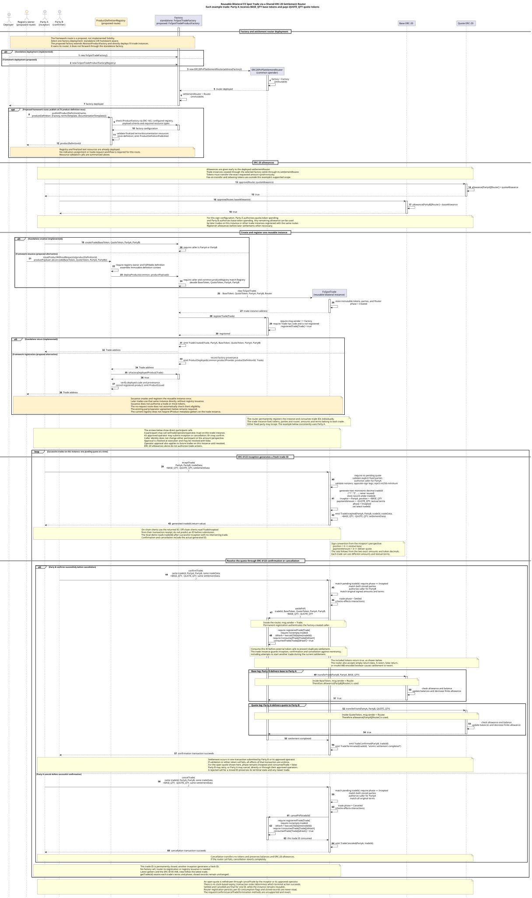

# FX Spot Trade demo

## Headless local demo

Run the lifecycle from one terminal with Python 3.9+ and Foundry (`forge`, `cast`,
and `anvil`) on `PATH`:

```bash
# From the repository root
python3 solidity/examples/fx-spot-trade/scripts/headless-demo.py
```

The runner builds the contracts, starts its own Anvil on an available loopback
port, deploys and funds the example tokens, and creates a router-registered trade.
It checks settlement, cancellation and successive trades on the same instance,
including exact balances, allowances and retained trade history. Each run stops
its Anvil process when finished, including on failure or interruption.

The automated scenario is:

1. Fund Party B with 5 BASE (18 decimals) and Party A with 10 QUOTE (6 decimals).
2. Incept trade `1`: Party A receives 1 BASE and pays 1.10 QUOTE. Attempt
   confirmation with only the BASE leg approved and verify atomic rollback.
3. Approve the QUOTE leg and settle trade `1`, consuming both exact allowances.
4. Let Party B incept and cancel trade `2`, with no token movements.
5. Approve an operator for both participants, settle trade `3` at the original
   amounts on their behalf, and revoke the operator approvals.

The final balances are 2 BASE / 7.80 QUOTE for Party A and 3 BASE / 2.20 QUOTE for
Party B. Trades `1` and `3` remain settled and trade `2` remains canceled.

The console prints the evidence directory and the result. To choose a fresh
output directory explicitly:

```bash
python3 solidity/examples/fx-spot-trade/scripts/headless-demo.py \
  --output /tmp/fx-spot-demo-run-1
```

Existing output directories are rejected so earlier evidence is preserved. The
report records the outcome and lifecycle checks alongside transaction receipts,
block-pinned state snapshots, build/chain logs and the contracts' ERC-8100 XML
templates. Token quantities are recorded as exact integer strings in smallest
token units. The XML files are templates; rendered XML and browser views remain
part of the renderer tour below.

This follows the automated deployment, workflow checks and evidence-reporting
approach of `smart-bond-contract`'s `BackendFixedRateBondDemo`. It drives the
existing FX contracts directly through local EVM RPC. The FX example has no
participant REST backends, Pontes adapters or product-definition registry
integration; the proposed framework integration is described at the end of this
guide. The runner uses only its own disposable local chain and requires no wallet
configuration or external service.

## FX Spot Trade lifecycle tour with Foundry and ERC-8100

This tour runs the included `FxSpotTrade` contracts locally and observes the trade instance and both example tokens through the generic ERC-8100 `EvmXmlRenderer`.

An FX Spot Trade exchanges two currency-token amounts through atomic
payment-versus-payment (PvP) settlement. This standalone demo supports successive
trades and operator approvals; the [ERC-6123 reference example](../../ercs/erc-6123/contracts/examples/FxSpotTrade/)
is single-use and requires direct participant calls.

The ERC-8100 view uses the same `SmartFinancialProduct` envelope as the bond
contracts, with an FX-specific state profile and a self-contained XSLT view.
See the [XML template and FpML mapping](resources/README.md).

Deploy the contracts from this directory for these calls. Existing deployments
retain their original methods and events; there are no compatibility aliases.
The XML envelope also requires a new factory/trade deployment; existing contracts
retain their original `stateXmlTemplate()` response.

The scenario is:

- `BASE` has 18 decimals.
- `QUOTE` has 6 decimals.
- Party A incepts a trade to **receive 1 BASE** and **pay 1.10 QUOTE**.
- Party B confirms the same parties and amounts, expressed from Party A's perspective.
- Confirmation transfers both ERC-20 legs atomically through the shared `ERC20PvPSettlementRouter`.

This example supports synchronous ERC-20 tokens that transfer the exact requested amount. Fee-on-transfer and rebasing tokens are outside its supported scope. The router checks call success and return data; it does not measure balance changes or enforce this token assumption on-chain.

The ERC-6123 trade methods take `inceptor` and `counterparty` explicitly. On
inception, the trade instance generates a new decimal trade ID (`"1"`, `"2"`, …), returns it,
and emits it in `TradeIncepted`. Confirmation and cancellation take that generated
ID followed by the original parties, signed amounts and text fields. IDs are unique
for the instance's lifetime, including across canceled trades.
A participant can submit its own action or approve an operator with
`setTradeOperator(operator, true)` on this trade instance. Inception and cancellation require
the inceptor's authority; confirmation requires the counterparty's authority.
Approvals are per participant and per trade instance, remain valid for future trades on that
instance until revoked with `false`, and are checked when the action executes.
ERC-20 router allowances alone do not authorize
a trade. Events and token transfers identify the participants, even when an operator
submits the transaction. Factory creation still requires a named participant.

Each trade instance fixes two tokens, two parties and a settlement router at deployment, and
handles successive trades with one open quote at a time. Amounts, textual terms and
the inceptor's role are chosen per trade; the exchange rate is expressed by the two
exact token amounts, with token decimals taken into account. Either fixed party may
incept the next trade. Settlement or cancellation closes that trade permanently,
then another inception generates a fresh ID on the same instance without another
factory call.

The inceptor can withdraw an open quote with `cancelTrade`. There is no clock-based
expiry: the quote remains open until confirmation or cancellation succeeds, with
transaction order deciding the outcome if both are submitted. Router registration
lasts for the instance's lifetime; the router consumes each trade ID separately.
Any remaining ERC-20 allowances can be reused, including by other trade instances registered
with the same router.

The renderer is used for three live contract views:

- the `BASE` token, showing metadata, total supply, tracked balances, and tracked allowances;
- the `QUOTE` token, showing the same ERC-20 state; and
- the `FxSpotTrade`, showing its fixed configuration and the latest trade's ID,
  lifecycle phase, and economic terms. Earlier records remain available through
  `getTrade(tradeId)`; the live XML view follows the latest trade.

For the trade instance view, the lifecycle phases are:

| Phase | Numeric value | Meaning in this tour |
|---|---:|---|
| `Created` | 0 | Factory-created and router-registered; no trade has been incepted yet |
| `Incepted` | 1 | Party A's signed amounts and textual terms are stored |
| `Settled` | 2 | Party B confirmed; both token transfers completed atomically |
| `Canceled` | 3 | Inceptor withdrew this quote and consumed its trade ID without transferring tokens |

`Settled` and `Canceled` are final for their trade ID. A new inception changes the
latest view to `Incepted`; it does not alter an earlier trade's terms or final phase.

The two token views evolve alongside the trade instance:

| Point in the tour | `BASE` ERC-8100 view | `QUOTE` ERC-8100 view |
|---|---|---|
| Deployed | Supply `0`; no tracked balances or allowances | Supply `0`; no tracked balances or allowances |
| Funded | Party B holds `5 BASE` | Party A holds `10 QUOTE` |
| Router approved | Party B allows the router to spend `1 BASE` | Party A allows the router to spend `1.10 QUOTE` |
| Settled | Party A holds `1 BASE`; Party B holds `4 BASE`; allowance is `0` | Party A holds `8.90 QUOTE`; Party B holds `1.10 QUOTE`; allowance is `0` |


### Required Installations

You need Foundry (for the chain tooling) and JBang (to start a web service with the renderer).
For installation instructions, see [the renderer setup page](https://representable-contract-state-b50ce5.gitlab.io/try-it/setup.html).
We also assume that `curl`, `cat`, `tr`, and `sed` are present.

**The following commands should be run in a *shell* (macOS Terminal, Windows Git Bash). You may use the copy button and just paste them into the shell.**

We need three terminal sessions:
1) one runs the blockchain (via `anvil`),
2) one runs a Java service (`EvmXmlRenderer`) to display the contract state in a browser,
3) one is used to issue commands to the blockchain.

The commands below use the standard local Anvil accounts. **The private keys are public test keys and must never hold real assets or be used on a public network.**

---

## Terminal 1 — start the local chain

Use chain ID 1337 because the renderer process below is configured for 1337.

Run:

```bash
anvil --chain-id 1337
```

Leave Anvil running.

---

## Terminal 2 — start the ERC-8100 renderer

The current renderer example uses release `2.8.0` and Java 21.

Run:

```bash
jbang --java 21 -Dethereum.rpcUrl=http://127.0.0.1:8545 -Dethereum.chainId=1337 net.finmath:representable-contract-state-web:2.8.0
```

Leave the renderer running. It serves rendered contract state on port 8080.

---

## Terminal 3 — deploy and walk through the lifecycle

### 0. Open the example project

From a checkout of `smart-financial-contracts`, enter the example directory:

```bash
cd solidity/examples/fx-spot-trade
```

This Foundry project includes the FX Spot Trade contracts, two Solidity test files,
and its compiler configuration. `contracts/ISDCTrade.sol` imports the shared
[ERC-6123 interface](../../ercs/erc-6123/contracts/ISDCTrade.sol) and `FxSpotTrade.sol`
imports the shared `TradeAuthorizable` and `TradeIdGenerator` helpers from this checkout;
keep the repository layout when building the example. Foundry 1.5.0 and Solidity
0.8.24 are used in CI. The tests require no downloaded Solidity dependencies,
running chain or renderer:

```bash
forge test -vv
```

The project layout is:

```text
.
├── foundry.toml
├── contracts/
│   ├── ERC20PvPSettlementRouter.sol
│   ├── ERC20TokenExample.sol
│   ├── FxSpotTrade.sol
│   ├── FxSpotTradeFactory.sol
│   ├── FxSpotTradeXml.sol
│   └── ISDCTrade.sol
├── resources/                         # XML template, schema and XSLT view
├── scripts/generate-xml-template.py
└── test/
    ├── FxSpotTrade.t.sol
    ├── TestSupport.sol
    └── xml/                            # ERC-8100 renderer integration tests
```

`ERC20TokenExample.sol` implements ERC-8100 in addition to its minimal ERC-20-style interface. Because Solidity mappings are not enumerable, the example records every balance account and allowance pair touched by its public operations and exposes them through `balanceEntries()` and `allowanceEntries()`. The renderer uses the ERC-8100 array-of-tuples profile to turn those views into repeated XML elements. Zero balances and consumed allowances remain visible once their keys have been tracked.

Run all commands from the root of this directory.

### 1. Configure the three local actors (Party A, Party B, and the contract deployer)

```bash
export RPC_URL="http://127.0.0.1:8545"

# Anvil account 0: deployer and unrestricted test-token minter
export DEPLOYER_PK="0xac0974bec39a17e36ba4a6b4d238ff944bacb478cbed5efcae784d7bf4f2ff80"

# Anvil account 1: Party A, the inceptor
export PARTY_A_PK="0x59c6995e998f97a5a0044966f0945389dc9e86dae88c7a8412f4603b6b78690d"

# Anvil account 2: Party B, the confirmer
export PARTY_B_PK="0x5de4111afa1a4b94908f83103eb1f1706367c2e68ca870fc3fb9a804cdab365a"

export DEPLOYER=$(cast wallet address --private-key "$DEPLOYER_PK")
export PARTY_A=$(cast wallet address --private-key "$PARTY_A_PK")
export PARTY_B=$(cast wallet address --private-key "$PARTY_B_PK")
export CHAIN_ID=$(cast chain-id --rpc-url "$RPC_URL")

printf '\nDeployer: %s\nParty A:  %s\nParty B:  %s\nChain ID: %s\n' \
  "$DEPLOYER" "$PARTY_A" "$PARTY_B" "$CHAIN_ID"

```

Expected output:

<pre>
Deployer: 0xf39Fd6e51aad88F6F4ce6aB8827279cffFb92266
Party A:  0x70997970C51812dc3A010C7d01b50e0d17dc79C8
Party B:  0x3C44CdDdB6a900fa2b585dd299e03d12FA4293BC
Chain ID: 1337
</pre>

### 2. Build the contracts

Run:

```bash
forge build
```

### 3. Deploy the two example ERC-20 tokens

The address extraction mirrors the command-line style of the ERC-8100 “Try It” example.

```bash
export BASE_TOKEN=$(
  forge create --use 0.8.24 --broadcast --root . --json \
    contracts/ERC20TokenExample.sol:ERC20TokenExample \
    --rpc-url "$RPC_URL" \
    --private-key "$DEPLOYER_PK" \
    --constructor-args "Example Base Token" "BASE" 18 \
  | tr -d '\r\n' \
  | sed -nE 's/.*"deployedTo"[[:space:]]*:[[:space:]]*"(0x[0-9a-fA-F]{40})".*/\1/p'
)

export QUOTE_TOKEN=$(
  forge create --use 0.8.24 --broadcast --root . --json \
    contracts/ERC20TokenExample.sol:ERC20TokenExample \
    --rpc-url "$RPC_URL" \
    --private-key "$DEPLOYER_PK" \
    --constructor-args "Example Quote Token" "QUOTE" 6 \
  | tr -d '\r\n' \
  | sed -nE 's/.*"deployedTo"[[:space:]]*:[[:space:]]*"(0x[0-9a-fA-F]{40})".*/\1/p'
)

printf '\nERC-20 Contracts deployed at following addresses:\nBASE token:  %s\nQUOTE token: %s\n' "$BASE_TOKEN" "$QUOTE_TOKEN"
```

Verify their metadata:

```bash
cast call "$BASE_TOKEN"  "name()(string)"     --rpc-url "$RPC_URL"
cast call "$BASE_TOKEN"  "symbol()(string)"   --rpc-url "$RPC_URL"
cast call "$BASE_TOKEN"  "decimals()(uint8)"  --rpc-url "$RPC_URL"
cast call "$QUOTE_TOKEN" "name()(string)"     --rpc-url "$RPC_URL"
cast call "$QUOTE_TOKEN" "symbol()(string)"   --rpc-url "$RPC_URL"
cast call "$QUOTE_TOKEN" "decimals()(uint8)"  --rpc-url "$RPC_URL"
```

### 3.1. Open the initial ERC-8100 token views

Both token contracts expose `stateXmlTemplate()`. Inspect both templates before opening one renderer URL per token:

```bash
cast call "$BASE_TOKEN"  "stateXmlTemplate()(string)" --rpc-url "$RPC_URL"
cast call "$QUOTE_TOKEN" "stateXmlTemplate()(string)" --rpc-url "$RPC_URL"
```

On **macOS**, open both live views with:

```bash
open "http://localhost:8080/xml?contract=$BASE_TOKEN"
open "http://localhost:8080/xml?contract=$QUOTE_TOKEN"
```

On **Windows/Git Bash**, open both live views with:

```bash
start "http://localhost:8080/xml?contract=$BASE_TOKEN"
start "http://localhost:8080/xml?contract=$QUOTE_TOKEN"
```

Immediately after deployment, each representation shows its name, symbol, decimals, and `TotalSupply = 0`. The `Balances` and `Allowances` collections are empty. Keep both browser tabs open and reload them after the token operations below.

### 4. Mint the initial balances

All quantities passed to contracts are integers in the token's smallest unit:

```bash
export BASE_QTY=1000000000000000000       # 1 BASE, with 18 decimals
export QUOTE_QTY=1100000                  # 1.10 QUOTE, with 6 decimals
export BASE_FUNDING=5000000000000000000   # 5 BASE
export QUOTE_FUNDING=10000000             # 10 QUOTE
```

Party B needs BASE; Party A needs QUOTE:

```bash
cast send "$BASE_TOKEN" \
  "mint(address,uint256)" "$PARTY_B" "$BASE_FUNDING" \
  --rpc-url "$RPC_URL" --private-key "$DEPLOYER_PK"

cast send "$QUOTE_TOKEN" \
  "mint(address,uint256)" "$PARTY_A" "$QUOTE_FUNDING" \
  --rpc-url "$RPC_URL" --private-key "$DEPLOYER_PK"
```

Check the initial balances:

```bash
cast call "$BASE_TOKEN"  "balanceOf(address)(uint256)" "$PARTY_A" --rpc-url "$RPC_URL"
cast call "$BASE_TOKEN"  "balanceOf(address)(uint256)" "$PARTY_B" --rpc-url "$RPC_URL"
cast call "$QUOTE_TOKEN" "balanceOf(address)(uint256)" "$PARTY_A" --rpc-url "$RPC_URL"
cast call "$QUOTE_TOKEN" "balanceOf(address)(uint256)" "$PARTY_B" --rpc-url "$RPC_URL"
```

Expected raw balances:

<pre>
                          BASE         QUOTE
Party A                      0      10000000
Party B    5000000000000000000             0
</pre>

### 4.1. ERC-8100 token snapshot — funded

**Reload** the two live token views (opened in step 3.1).

Each token representation shows a balance for Party A or Party B. No allowance entry exists yet.

### 5. Deploy the factory and obtain its router

The factory constructor deploys exactly one shared `ERC20PvPSettlementRouter`:

```bash
export FACTORY=$(
  forge create --use 0.8.24 --broadcast --root . --json \
    contracts/FxSpotTradeFactory.sol:FxSpotTradeFactory \
    --rpc-url "$RPC_URL" \
    --private-key "$DEPLOYER_PK" \
  | tr -d '\r\n' \
  | sed -nE 's/.*"deployedTo"[[:space:]]*:[[:space:]]*"(0x[0-9a-fA-F]{40})".*/\1/p'
)

export ROUTER=$(cast call "$FACTORY" \
  "settlementRouter()(address)" \
  --rpc-url "$RPC_URL")

cast call "$ROUTER" "factory()(address)" --rpc-url "$RPC_URL"

printf '\nFactory: %s\nRouter:  %s\n' "$FACTORY" "$ROUTER"
```

The final call should return the factory address.

### 6. Approve the shared settlement router

The parties approve the router—not the factory and not the individual trade instance:

```bash
# Party A will deliver 1.10 QUOTE.
cast send "$QUOTE_TOKEN" \
  "approve(address,uint256)" "$ROUTER" "$QUOTE_QTY" \
  --rpc-url "$RPC_URL" --private-key "$PARTY_A_PK"

# Party B will deliver 1 BASE.
cast send "$BASE_TOKEN" \
  "approve(address,uint256)" "$ROUTER" "$BASE_QTY" \
  --rpc-url "$RPC_URL" --private-key "$PARTY_B_PK"
```

Verify the allowances:

```bash
cast call "$QUOTE_TOKEN" "allowance(address,address)(uint256)" \
  "$PARTY_A" "$ROUTER" --rpc-url "$RPC_URL"

cast call "$BASE_TOKEN" "allowance(address,address)(uint256)" \
  "$PARTY_B" "$ROUTER" --rpc-url "$RPC_URL"
```

Expected values are `1100000` and `1000000000000000000`.

### 6.1. ERC-8100 token snapshot — router approved

Reload the two live token views (opened in step 3.1).

The `Allowances` collections now contain the exact settlement permissions.

```text
<ERC20TokenExample xmlns="urn:example:erc20-token" xmlns:evmstate="urn:evm:state:1.0" evmstate:block-number="45" evmstate:chain-id="1337" evmstate:contract-address="0xa85233C63b9Ee964Add6F2cffe00Fd84eb32338f" evmstate:renderer-id="net.finmath.smartcontracts.representablestate.xml.EvmXmlRenderer" evmstate:renderer-url="http://finmath.gitlab.io/representable-contract-state" evmstate:renderer-version="2.8.0">
	<Metadata>
		<Name>Example Base Token</Name>
		<Symbol>BASE</Symbol>
		<Decimals>18</Decimals>
	</Metadata>
	<TotalSupply unit="smallest-token-unit">5000000000000000000</TotalSupply>
	<Balances unit="smallest-token-unit">
		<Balance>
			<Account>0x3C44CdDdB6a900fa2b585dd299e03d12FA4293BC</Account>
			<Amount>5000000000000000000</Amount>
		</Balance>
	</Balances>
	<Allowances unit="smallest-token-unit">
		<Allowance>
			<Owner>0x3C44CdDdB6a900fa2b585dd299e03d12FA4293BC</Owner>
			<Spender>0xf0D7de80A1C242fA3C738b083C422d65c6c7ABF1</Spender>
			<Amount>1000000000000000000</Amount>
		</Allowance>
	</Allowances>
</ERC20TokenExample>
```

The account and spender addresses in the XML are resolved from the same fixed block as the amounts.

### 7. Create and register one reusable `FxSpotTrade`

`cast send` does not expose the Solidity return value directly. On this isolated local chain, first simulate the call to obtain the address the factory will create; then send the identical transaction. The predicted address remains valid provided no other `createTrade` transaction reaches this factory between the two commands.

```bash
export TRADE=$(cast call "$FACTORY" \
  "createTrade(address,address,address,address)(address)" \
  "$BASE_TOKEN" "$QUOTE_TOKEN" "$PARTY_A" "$PARTY_B" \
  --from "$PARTY_A" \
  --rpc-url "$RPC_URL")

cast send "$FACTORY" \
  "createTrade(address,address,address,address)" \
  "$BASE_TOKEN" "$QUOTE_TOKEN" "$PARTY_A" "$PARTY_B" \
  --rpc-url "$RPC_URL" --private-key "$PARTY_A_PK"

printf '\nTrade: %s\n' "$TRADE"
```

The factory emits `TradeCreated`; its first indexed argument, `trade`, identifies
the deployed instance. The remaining arguments are `creator`, `baseToken`,
`quoteToken`, `partyA` and `partyB`.

Verify that the trade instance is registered and that its fixed configuration matches the factory call:

```bash
cast call "$ROUTER" "registeredTrade(address)(bool)" "$TRADE" --rpc-url "$RPC_URL"
cast call "$TRADE" "phase()(uint8)"                  --rpc-url "$RPC_URL"
cast call "$TRADE" "partyA()(address)"               --rpc-url "$RPC_URL"
cast call "$TRADE" "partyB()(address)"               --rpc-url "$RPC_URL"
cast call "$TRADE" "baseToken()(address)"            --rpc-url "$RPC_URL"
cast call "$TRADE" "quoteToken()(address)"           --rpc-url "$RPC_URL"
cast call "$TRADE" "settlementRouter()(address)"     --rpc-url "$RPC_URL"
```

Expected lifecycle values:

<pre>
registeredTrade = true
phase          = 0  (Created)
</pre>

### 8. ERC-8100 snapshot 1 — `Created`

On **macOS**, open the live view of the trade instance with:

```bash
open "http://localhost:8080/xml?contract=$TRADE"
```

On **Windows/Git Bash**, open the live view of the trade instance with:

```bash
start "http://localhost:8080/xml?contract=$TRADE"
```

At this point, the rendered representation should show conceptually:

```xml
<Lifecycle>
  <TradeId></TradeId>
  <Phase>0</Phase>
  <Inceptor>0x0000000000000000000000000000000000000000</Inceptor>
</Lifecycle>
<Terms view="inceptor">
  <Position ...>0</Position>
  <PaymentAmount ...>0</PaymentAmount>
  <TradeData></TradeData>
  <InitialSettlementData></InitialSettlementData>
</Terms>
```

The root is `SmartFinancialProduct` in namespace
`urn:smart-product-framework:financial-product:1.0`, with `type="FxSpotTrade"`.
It records the rendered chain ID, trade instance address and block number.
The `FxSpotTrade` state is nested under `ProductResources/ProductTermsTemplate`
in namespace `urn:example:fx-spot-trade`; the router is under `DeploymentState`.
Exact whitespace and whether binding attributes remain visible are renderer
serialization details.

### 9. Incept the trade as Party A

The economic terms are signed from Party A's perspective. Submit inception, then
read the ID generated by the successful transaction:

```bash
export TRADE_DATA="FX spot: Party A receives 1 BASE and pays 1.10 QUOTE"
export SETTLEMENT_DATA="Atomic payment-versus-payment at confirmation"

cast send "$TRADE" \
  "inceptTrade(address,address,string,int256,int256,string)" \
  "$PARTY_A" \
  "$PARTY_B" \
  "$TRADE_DATA" \
  "$BASE_QTY" \
  "-$QUOTE_QTY" \
  "$SETTLEMENT_DATA" \
  --rpc-url "$RPC_URL" --private-key "$PARTY_A_PK"

# Read after successful inception on this isolated local chain.
export TRADE_ID=$(cast call "$TRADE" "tradeId()(string)" --rpc-url "$RPC_URL" | tr -d '"')
printf 'Generated trade ID: %s\n' "$TRADE_ID"
```

For the first inception on a new instance, the generated ID is `"1"`. An on-chain
client obtains it from the return value. Off-chain clients should obtain the ID
from `TradeIncepted` in their transaction receipt. This isolated walkthrough uses
the latest-ID getter after successful inception, assuming no intervening trade;
do not predict an ID before submitting the transaction.

Here:

```text
position      = +1000000000000000000  -> Party A receives 1 BASE
paymentAmount = -1100000              -> Party A delivers 1.10 QUOTE
```

Check the contract directly:

```bash
cast call "$TRADE" "phase()(uint8)"                        --rpc-url "$RPC_URL"
cast call "$TRADE" "tradeId()(string)"                     --rpc-url "$RPC_URL"
cast call "$TRADE" "inceptor()(address)"                  --rpc-url "$RPC_URL"
cast call "$TRADE" "position()(int256)"                   --rpc-url "$RPC_URL"
cast call "$TRADE" "paymentAmount()(int256)"              --rpc-url "$RPC_URL"
cast call "$TRADE" "tradeData()(string)"                  --rpc-url "$RPC_URL"
cast call "$TRADE" "initialSettlementData()(string)"      --rpc-url "$RPC_URL"
```

### 10. ERC-8100 snapshot 2 — `Incepted`

**Reload** the browser page showing the trade instance state (opened in step 8), or open the view again:

On **macOS**, open the live view of the trade instance with:

```bash
open "http://localhost:8080/xml?contract=$TRADE"
```

On **Windows/Git Bash**, open the live view of the trade instance with:

```bash
start "http://localhost:8080/xml?contract=$TRADE"
```

The same XML template now resolves to:

<pre>
TradeId               value of TRADE_ID (initially "1")
Phase                 1
Inceptor              Party A
Position              1000000000000000000
PaymentAmount         -1100000
TradeData             FX spot: Party A receives 1 BASE and pays 1.10 QUOTE
InitialSettlementData Atomic payment-versus-payment at confirmation
</pre>

The contract address remains the same, while the root block number advances.

### 10.1. Optional alternative: cancel the open quote as Party A

To withdraw this quote, run the following **before step 11**. Party A supplies the
generated ID and repeats the original inception terms, including their original signs:

```bash
cast send "$TRADE" \
  "cancelTrade(string,address,address,string,int256,int256,string)" \
  "$TRADE_ID" \
  "$PARTY_A" \
  "$PARTY_B" \
  "$TRADE_DATA" \
  "$BASE_QTY" \
  "-$QUOTE_QTY" \
  "$SETTLEMENT_DATA" \
  --rpc-url "$RPC_URL" --private-key "$PARTY_A_PK"

cast call "$TRADE" "phase()(uint8)" --rpc-url "$RPC_URL"
cast call "$ROUTER" "registeredTrade(address)(bool)" "$TRADE" --rpc-url "$RPC_URL"
cast call "$ROUTER" "consumedTrade(address,bytes32)(bool)" \
  "$TRADE" "$(cast keccak "$(cast from-utf8 "$TRADE_ID")")" --rpc-url "$RPC_URL"
```

Expected values are `phase = 3` (`Canceled`), `registeredTrade = true` and
`consumedTrade = true` for this ID. The trade instance changes the trade's phase and calls
`cancelPvP(TRADE_ID)` on the router in the same transaction, then emits
`TradeCanceled`. If the router call fails, cancellation reverts completely.

Reload the trade instance's XML view to see the canceled phase with the inception terms retained. Both token balances and ERC-20 allowances remain unchanged: Party B still holds 5 BASE and allows 1 BASE to the router; Party A still holds 10 QUOTE and allows 1.10 QUOTE to the router.

**After cancellation, do not confirm the canceled ID.** To run the settlement path,
repeat steps 9–10 on this same trade instance, then proceed to step 11. The replacement
inception generates a new ID, which step 9 captures in `TRADE_ID`; the canceled
record remains closed. Existing router allowances remain sufficient because
cancellation did not consume them.

### 10.2. Optional: submit confirmation through an operator

Party B can authorize the deployer account to submit its confirmation:

```bash
cast send "$TRADE" "setTradeOperator(address,bool)" "$DEPLOYER" true \
  --rpc-url "$RPC_URL" --private-key "$PARTY_B_PK"
```

For step 11, use `--private-key "$DEPLOYER_PK"` instead of `"$PARTY_B_PK"`.
Keep all explicit trade arguments unchanged. The deployer receives no tokens;
the router still transfers between Party A and Party B. The operator may act for
Party B on this trade instance, including future trades until revoked. Party A would need to
grant its own approval for an operator to incept or cancel on its behalf. In a
future trade where Party B is the inceptor, its operator may incept or cancel that
trade instead of confirming it.

To revoke the approval, Party B submits:

```bash
cast send "$TRADE" "setTradeOperator(address,bool)" "$DEPLOYER" false \
  --rpc-url "$RPC_URL" --private-key "$PARTY_B_PK"
```

After revocation, the operator's pending confirmation cannot execute. Party B can
still submit directly, or grant a new approval.

### 11. Confirm as Party B and settle both legs

Party B supplies the generated ID followed by the exact inception arguments. The
amounts retain Party A's perspective; they are not negated:

```bash
cast send "$TRADE" \
  "confirmTrade(string,address,address,string,int256,int256,string)" \
  "$TRADE_ID" \
  "$PARTY_A" \
  "$PARTY_B" \
  "$TRADE_DATA" \
  "$BASE_QTY" \
  "-$QUOTE_QTY" \
  "$SETTLEMENT_DATA" \
  --rpc-url "$RPC_URL" --private-key "$PARTY_B_PK"
```

Within this single confirmation transaction:

1. `FxSpotTrade` verifies the caller's authority for Party B and matches the open trade's ID, both explicit parties, original signed amounts, and text terms.
2. It changes the trade's `phase` to `Settled` before the external call. A reentrancy guard covers inception, confirmation and cancellation on this instance.
3. The router requires permanent registration and consumes `consumedTrade[TRADE][keccak256(bytes(TRADE_ID))]` before calling either token.
4. The router transfers 1 BASE from Party B to Party A.
5. The router transfers 1.10 QUOTE from Party A to Party B.
6. Any failure reverts the complete transaction, including both token legs and both state changes.

If confirmation fails, the trade remains `Incepted` and its router consumption flag
remains `false`. Party B can retry after correcting the cause (for example, an
insufficient allowance), or Party A can cancel using step 10.1. Once confirmation
succeeds, this ID cannot be canceled, confirmed again or used for a new inception.

### 12. ERC-8100 snapshot 3 — `Settled`

**Reload** the browser page showing the trade instance state (opened in step 8), or open the view again:

On **macOS**, open the live view of the trade instance with:

```bash
open "http://localhost:8080/xml?contract=$TRADE"
```

On **Windows/Git Bash**, open the live view of the trade instance with:

```bash
start "http://localhost:8080/xml?contract=$TRADE"
```

The renderer should now show `Phase = 2` and the completed trade's ID and terms.
The view retains this record until the next inception. `getTrade(TRADE_ID)` retains
the record after subsequent trades too.

### 12.1. ERC-8100 token snapshots — atomic settlement reflected

The same confirmation transaction also changes both token representations.

**Reload** the token tabs, or save final snapshots.

The final token views should show:

<pre>
BASE balances
  Party B  4000000000000000000
  Party A  1000000000000000000
BASE allowance
  Party B -> Router  0

QUOTE balances
  Party A  8900000
  Party B  1100000
QUOTE allowance
  Party A -> Router  0
</pre>

The zero allowance rows remain present because the owner/spender pairs were previously tracked. This makes the transition from an approved to a consumed allowance visible in the rendered state.

### 13. Verify the final atomic settlement

```bash
cast call "$TRADE"   "phase()(uint8)"                         --rpc-url "$RPC_URL"
cast call "$ROUTER" "registeredTrade(address)(bool)" "$TRADE" --rpc-url "$RPC_URL"
cast call "$ROUTER" "consumedTrade(address,bytes32)(bool)" \
  "$TRADE" "$(cast keccak "$(cast from-utf8 "$TRADE_ID")")" --rpc-url "$RPC_URL"

cast call "$BASE_TOKEN"  "balanceOf(address)(uint256)" "$PARTY_A" --rpc-url "$RPC_URL"
cast call "$BASE_TOKEN"  "balanceOf(address)(uint256)" "$PARTY_B" --rpc-url "$RPC_URL"
cast call "$QUOTE_TOKEN" "balanceOf(address)(uint256)" "$PARTY_A" --rpc-url "$RPC_URL"
cast call "$QUOTE_TOKEN" "balanceOf(address)(uint256)" "$PARTY_B" --rpc-url "$RPC_URL"

cast call "$BASE_TOKEN" "allowance(address,address)(uint256)" \
  "$PARTY_B" "$ROUTER" --rpc-url "$RPC_URL"
cast call "$QUOTE_TOKEN" "allowance(address,address)(uint256)" \
  "$PARTY_A" "$ROUTER" --rpc-url "$RPC_URL"
```

Expected final values:

<pre>
phase                  2  (Settled)
registeredTrade         true
consumedTrade          true  (for this trade ID)

Party A BASE           1000000000000000000  = 1 BASE
Party A QUOTE          8900000              = 8.90 QUOTE
Party B BASE           4000000000000000000  = 4 BASE
Party B QUOTE          1100000              = 1.10 QUOTE

Party B BASE allowance 0
Party A QUOTE allowance 0
</pre>

Because exact settlement allowances were granted, both are fully consumed. The direct `cast call` results should match the two final ERC-8100 token representations.

### 14. Settle a second trade on the same instance

Keep `TRADE`, the tokens, parties and router unchanged. This time Party A receives
1 BASE for 1.12 QUOTE. The rate comes from the exact amounts `1000000000000000000`
and `1120000`; there is no separate exchange-rate field or rounding calculation.
Replenish the allowances consumed by the first settlement, then capture the new
ID after inception succeeds:

```bash
export SECOND_QUOTE_QTY="1120000"
export SECOND_TRADE_DATA="FX spot: Party A receives 1 BASE and pays 1.12 QUOTE"

cast send "$BASE_TOKEN" "approve(address,uint256)" "$ROUTER" "$BASE_QTY" \
  --rpc-url "$RPC_URL" --private-key "$PARTY_B_PK"
cast send "$QUOTE_TOKEN" "approve(address,uint256)" "$ROUTER" "$SECOND_QUOTE_QTY" \
  --rpc-url "$RPC_URL" --private-key "$PARTY_A_PK"

cast send "$TRADE" \
  "inceptTrade(address,address,string,int256,int256,string)" \
  "$PARTY_A" "$PARTY_B" "$SECOND_TRADE_DATA" \
  "$BASE_QTY" "-$SECOND_QUOTE_QTY" "$SETTLEMENT_DATA" \
  --rpc-url "$RPC_URL" --private-key "$PARTY_A_PK"

# Read after successful inception, as in step 9.
export SECOND_TRADE_ID=$(cast call "$TRADE" "tradeId()(string)" --rpc-url "$RPC_URL" | tr -d '"')
printf 'Generated second trade ID: %s\n' "$SECOND_TRADE_ID"

cast send "$TRADE" \
  "confirmTrade(string,address,address,string,int256,int256,string)" \
  "$SECOND_TRADE_ID" "$PARTY_A" "$PARTY_B" "$SECOND_TRADE_DATA" \
  "$BASE_QTY" "-$SECOND_QUOTE_QTY" "$SETTLEMENT_DATA" \
  --rpc-url "$RPC_URL" --private-key "$PARTY_B_PK"
```

Reloading the trade instance's XML view now shows the captured `SECOND_TRADE_ID`, `Phase = 2`,
and the new amounts and text. The ID is `"2"` on the direct settlement path, or
`"3"` if the optional cancellation and replacement were performed. Party A holds
2 BASE and 7.78 QUOTE; Party B holds 3 BASE and 2.22 QUOTE. Both exact allowances
are again fully consumed.

The latest getters and both historical records can be queried independently:

```bash
cast call "$TRADE" "tradeId()(string)" --rpc-url "$RPC_URL"
cast call "$TRADE" "phase()(uint8)" --rpc-url "$RPC_URL"

cast call "$TRADE" "getTrade(string)((uint8,address,int256,int256,string,string))" \
  "$TRADE_ID" --rpc-url "$RPC_URL"
cast call "$TRADE" "getTrade(string)((uint8,address,int256,int256,string,string))" \
  "$SECOND_TRADE_ID" --rpc-url "$RPC_URL"
```

Each record contains `(phase, inceptor, position, paymentAmount, tradeData,
initialSettlementData)`. The counterparty is the other member of the fixed pair.
Both records have phase `2`; the first payment amount remains `-1100000` and the
second is `-1120000`. Unknown IDs revert. A stale confirmation or cancellation
for the first ID cannot act on the second trade, even if their economic terms
were identical. A third inception generates another ID and can proceed on the
same instance; an inception while a quote is still open is rejected.

## Automated contract tests

In a repository checkout, run the Foundry tests from the repository root:

```bash
forge test --root solidity/examples/fx-spot-trade -vv
```

The tests run locally without Anvil or the renderer service. They cover settlement,
permissions and matching terms, cancellation and authorization revocation,
failed-transfer rollback, sequential reuse, trade history, ID replay protection,
and reentrancy during settlement.

With Java 21 and Maven, the XML integration tests start an isolated Anvil chain
and use the real ERC-8100 renderer. From the example directory:

```bash
python3 scripts/generate-xml-template.py --check
forge build
mvn -B -f test/xml/pom.xml test
```

They validate the common envelope and FX schema, exact amounts, payer/receiver
directions, lifecycle snapshots, text escaping and the embedded stylesheet digest.

## Standards and renderer references

- ERC-8100 draft: `https://eips.ethereum.org/EIPS/eip-8100`
- Current renderer “Try It” example: `https://representable-contract-state-b50ce5.gitlab.io/try-it/index.html`
- ERC-6123: `https://eips.ethereum.org/EIPS/eip-6123`

## Proposed Smart Product Framework integration

The standalone trade instance already has a separate reusable factory. A lightweight framework
integration can keep `FxSpotTrade` and its settlement router unchanged and add an
alternative `FxSpotTradeProductFactory` in the framework package. This is a design
proposal; the factory described here is not yet implemented.

The proposed factory would extend `AbstractProductFactory` and:

- Receive the authorized `ProductDefinitionRegistry` in its constructor and deploy
  one `ERC20PvPSettlementRouter` with itself as the immutable factory.
- Describe an ABI-encoded payload `(baseToken, quoteToken, partyA, partyB)` and expose
  the required terms/documentation resource-type identifiers. Initially,
  `isAcceptedIndicationCategory` can return `false`.
- Implement `_deployProduct` by decoding that payload, deploying the existing
  `FxSpotTrade`, and calling its own router's `registerTrade` in the same transaction.
  The base factory records deployment provenance and emits `ProductDeployed`.

Use one factory deployment for the selected route. The framework factory is an
alternative to the standalone factory, not an additional forwarding layer. Calling
`createTrade` on the standalone factory from an adapter would fail its participant
check; an adapter also cannot register trade instances with a router owned by another factory.

The registry owner first publishes an FX definition referencing this factory and
finalized terms/documentation resources. It can then call
`issueProductWithoutRequests({productDefinitionId, productPayload})`. The registry
assembles the common definition context, invokes `deployProduct`, verifies the
factory's provenance record, and records/emits the issued product. Trade requests
and indications can be introduced later without putting them in this initial path.

Issuance leaves the reusable trade instance in `Created`. The actual participants and their
authorized operators establish each trade's economic terms through the ERC-6123
inception and confirmation calls, directly on that instance. Later trades require
neither another deployment nor another registry issuance. The payload identifies
the participants independently of
`common.productProvider`, which the current registry sets to its owner. Issuance
neither establishes party consent nor moves tokens. The no-request path does not
perform automatic client-eligibility checks; any required policy would need an
explicit factory check or the appropriate request workflow.

The current registry verifies deployed code and factory provenance; it does not
require `IProduct` metadata getters on the returned trade instance. This makes factory-only
integration sufficient for issuance and registry discovery. Generic consumers that
expect `productFactory`, `productDefinitionId`, or the other `IProduct` getters would
need a small metadata extension later. The existing FX ERC-8100 view remains usable.

The factory deploys and registers reusable bilateral trade instances; each instance
manages its own sequence of trade records. A new token pair or participant pair
requires a new instance, while new rates and amounts do not.
The diagram below marks the proposed framework path separately from implemented calls.

## Sequence Diagram

<a href="FxSpotTradeSequence.svg">
    
</a>
